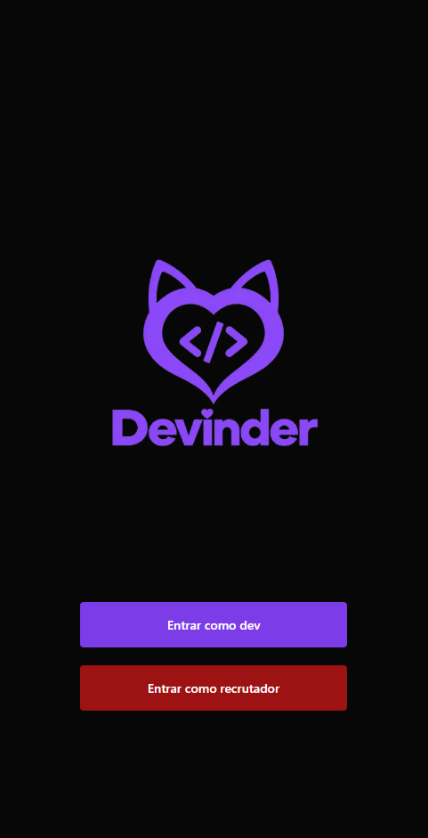
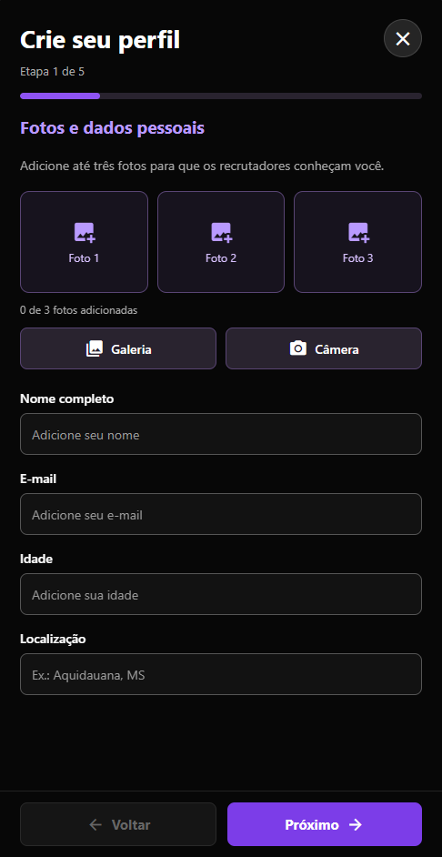
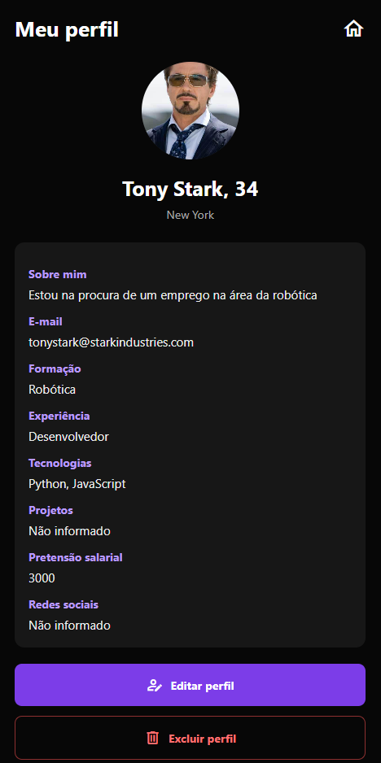
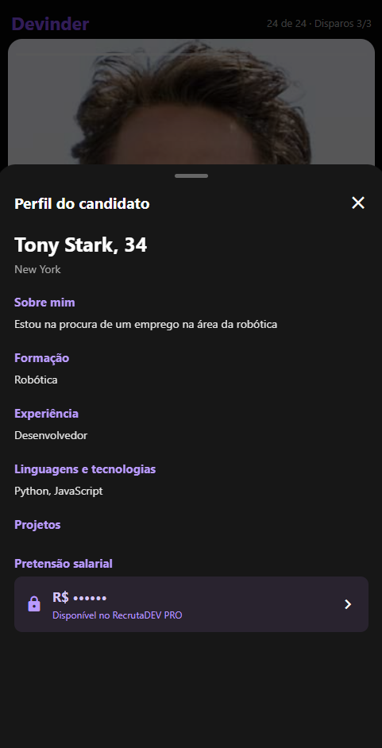
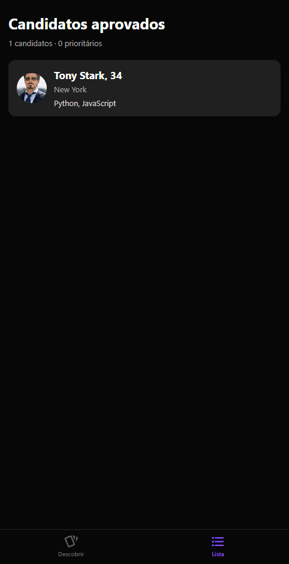
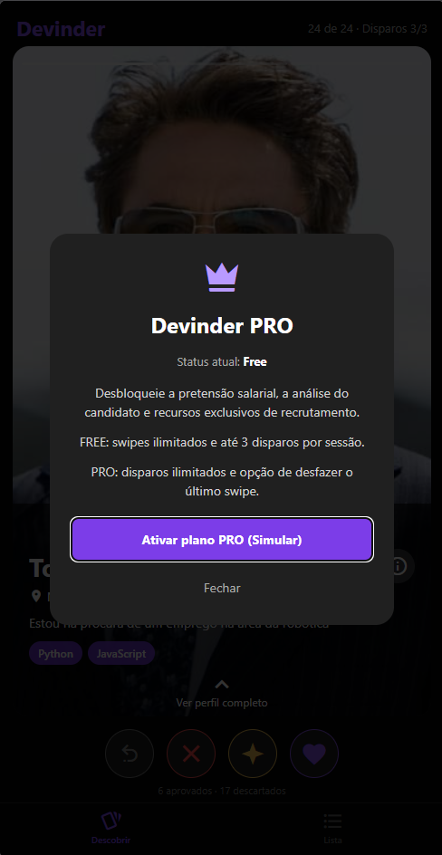

# Devinder

Aplicativo mobile desenvolvido com React Native, Expo e TypeScript. O Devinder permite que desenvolvedores montem seus perfis e que recrutadores visualizem e avaliem candidatos.

## Protótipo no Figma

Link do Figma: https://www.figma.com/design/BXCS9xKIastcjzZY3n6ci6/Devinder?node-id=0-1&t=6fBipoXUDteyAMXc-1

## Capturas de tela

Adicione as capturas de tela do aplicativo na pasta `docs/screenshots/` do repositório, usando os nomes indicados abaixo. As imagens aparecerão nesta seção depois que forem adicionadas e enviadas ao GitHub.

### Tela inicial



### Cadastro de desenvolvedor



### Perfil do desenvolvedor



### Descoberta de candidatos


### Detalhes do candidato



### Lista de candidatos aprovados



### Apresentação do plano PRO



## 1. Tecnologias utilizadas

- **React Native:** construção das interfaces mobile.
- **Expo:** ambiente e ferramentas de desenvolvimento.
- **Expo Router:** navegação entre as telas.
- **TypeScript:** tipagem do código.
- **AsyncStorage:** armazenamento local dos candidatos cadastrados.
- **Expo Image Picker:** seleção de imagens da galeria e captura de fotos.
- **React Native Gesture Handler, Reanimated e Worklets:** gestos e animações dos cartões de candidatos.
- **MaterialCommunityIcons (`@expo/vector-icons`):** ícones da interface.

As dependências e os scripts do projeto estão declarados em `package.json`.

## 2. Como executar o projeto

### Pré-requisitos

- Node.js instalado.
- npm instalado.
- Expo Go ou um ambiente de execução compatível com o projeto.

### Instalação

```bash
git clone https://github.com/Leroy-jester/Trabalho-de-Dispotivos-m-veis.git
cd Trabalho-de-Dispotivos-m-veis
npm install
```

### Inicialização

```bash
npx expo start
```

O projeto também declara os comandos abaixo, conforme o ambiente configurado:

```bash
npm run android
npm run ios
npm run web
```

## 3. Estrutura do projeto

```text
src/
├── app/
│   ├── index.tsx
│   ├── dev-cadastro.tsx
│   ├── dev-perfil.tsx
│   ├── _layout.tsx
│   └── recrutador/
│       ├── index.tsx
│       ├── lista.tsx
│       └── _layout.tsx
├── components/
│   ├── button.tsx
│   ├── candidate-card.tsx
│   └── pro-modal.tsx
└── contexts/
    └── recruitment-context.tsx

assets/
└── images/

docs/
└── screenshots/
```

### Principais arquivos

- `src/app/index.tsx`: tela inicial com acesso à área de desenvolvedor e à área de recrutador.
- `src/app/dev-cadastro.tsx`: cadastro e edição dos dados do desenvolvedor.
- `src/app/dev-perfil.tsx`: visualização, edição e exclusão do perfil do desenvolvedor.
- `src/app/recrutador/index.tsx`: descoberta e avaliação de candidatos.
- `src/app/recrutador/lista.tsx`: lista de candidatos aprovados.
- `src/app/recrutador/_layout.tsx`: navegação por abas da área de recrutador.
- `src/components/button.tsx`: componente reutilizável de botão.
- `src/components/candidate-card.tsx`: cartão de candidato com fotos, gestos e ações de avaliação.
- `src/contexts/recruitment-context.tsx`: estado compartilhado e operações relacionadas aos candidatos.
- `package.json`: dependências e comandos do projeto.
- `app.json`: configurações do Expo.

## 4. Funcionalidades

### 4.1. Tela inicial

Apresenta a marca Devinder e opções para entrar como desenvolvedor ou recrutador.

### 4.2. Cadastro e perfil de desenvolvedor

O formulário de cadastro é dividido em cinco etapas:

1. **Fotos e dados pessoais:** nome, e-mail, idade, localização e fotos.
2. **Sobre você:** descrição pessoal.
3. **Formação e experiência:** informações de formação e experiência profissional, incluindo períodos.
4. **Tecnologias e projetos:** linguagens, tecnologias e projetos desenvolvidos.
5. **Informações finais:** pretensão salarial e redes sociais.

O formulário permite selecionar fotos da galeria ou usar a câmera, quando disponível, e aceita até três fotos. Também permite editar e excluir um perfil. Os candidatos cadastrados são armazenados localmente.

### 4.3. Descoberta e avaliação de candidatos

A área de recrutador exibe candidatos em cartões e oferece:

- Visualização e navegação entre as fotos do perfil.
- Gesto horizontal para aprovar ou descartar candidatos.
- Controles para aprovar, descartar e marcar um candidato como prioritário por meio de disparo.
- Abertura dos detalhes do candidato, incluindo o gesto para cima.
- Contadores relacionados às ações de recrutamento.
- Mensagem ao chegar ao final dos perfis, com opção de reiniciar a visualização.
- Zoom da foto por gesto de pinça, conforme o suporte do ambiente de execução.

### 4.4. Detalhes do candidato

A área de detalhes apresenta dados como nome, idade, localização, descrição pessoal, formação, experiência, tecnologias e projetos. A pretensão salarial é apresentada como informação restrita para o plano Free.

### 4.5. Lista de candidatos aprovados

A aba **Lista** reúne os candidatos aprovados. Os candidatos marcados como prioritários aparecem antes dos demais aprovados e recebem um indicador visual. Quando não há candidatos aprovados, a tela exibe uma mensagem de lista vazia.

### 4.6. Armazenamento local

O contexto `recruitment-context.tsx` utiliza AsyncStorage, com a chave `@recrutadev:candidatos`, para carregar e salvar a lista de candidatos. O projeto também contém perfis de demonstração definidos no código.

## 5. Plano Free e recursos PRO

O projeto apresenta uma experiência Free e uma janela informativa do RecrutaDEV PRO. Os recursos de plano estão simulados no aplicativo, sem integração com um serviço de assinatura ou pagamento.

### Plano Free

- Avaliação normal de candidatos por aprovação e descarte.
- Limite de três disparos por sessão.
- Pretensão salarial protegida por um bloqueio visual.
- Apresentação da janela PRO quando uma ação restrita é solicitada.

### Recursos previstos para o PRO

- Disparos sem o limite do plano Free.
- Acesso à pretensão salarial.
- Recurso para desfazer o último descarte (Revert).
- Análise do candidato.

**Observação:** a janela PRO é informativa. O projeto não possui fluxo de compra, cobrança ou gerenciamento de assinatura. A funcionalidade específica de análise do candidato e a validação completa de todos os recursos PRO ainda precisam ser concluídas ou demonstradas nos testes.

## 6. Dados dos candidatos

O tipo `Candidate`, definido no contexto, contempla os seguintes campos:

- `id`
- `nome`
- `idade`
- `localizacao`
- `sobre`
- `linguagens`
- `formacao`
- `experiencia`
- `projetos`
- `pretensaoSalarial`
- `fotos`
- `email` (opcional)
- `formacaoInicio` e `formacaoFim` (opcionais)
- `experienciaInicio` e `experienciaFim` (opcionais)
- `redesSociais` (opcional)

Os perfis de demonstração usam imagens externas, cuja exibição depende de acesso à internet.

## 7.  Limitações e observações

- O plano PRO está simulado e não há integração com compra ou assinatura real.
- Os dados dos candidatos são armazenados localmente; o projeto não utiliza uma API remota para esse armazenamento.
- A lista inicial inclui candidatos de demonstração.
- A persistência das aprovações, dos descartes, das prioridades e dos disparos deve ser verificada separadamente dos dados dos candidatos.
- A funcionalidade de análise do candidato precisa ser implementada ou validada.
- Os resultados dos testes devem ser preenchidos após a execução em dispositivo ou emulador.

## 8. Integrantes

- George Lucas
- Josef Ferreira
- Gabriel Rangel
- Lucas Silva

## 9. Repositório

https://github.com/Leroy-jester/Trabalho-de-Dispotivos-m-veis
